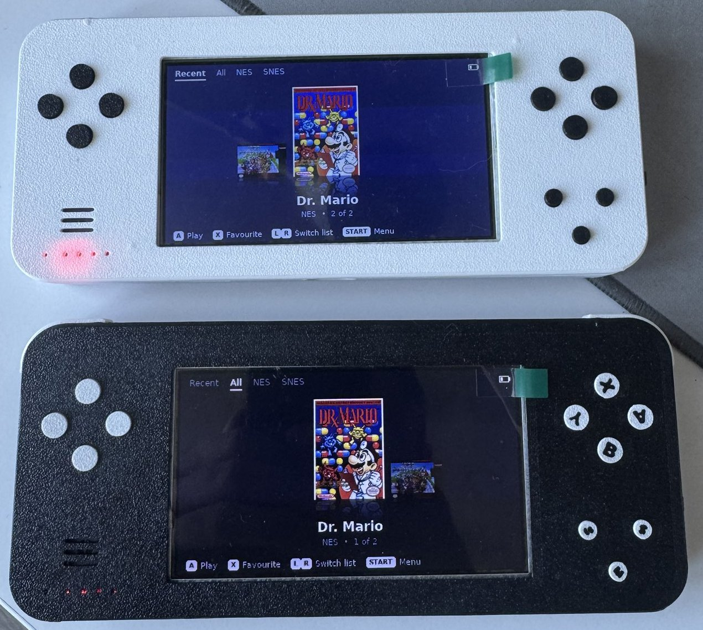
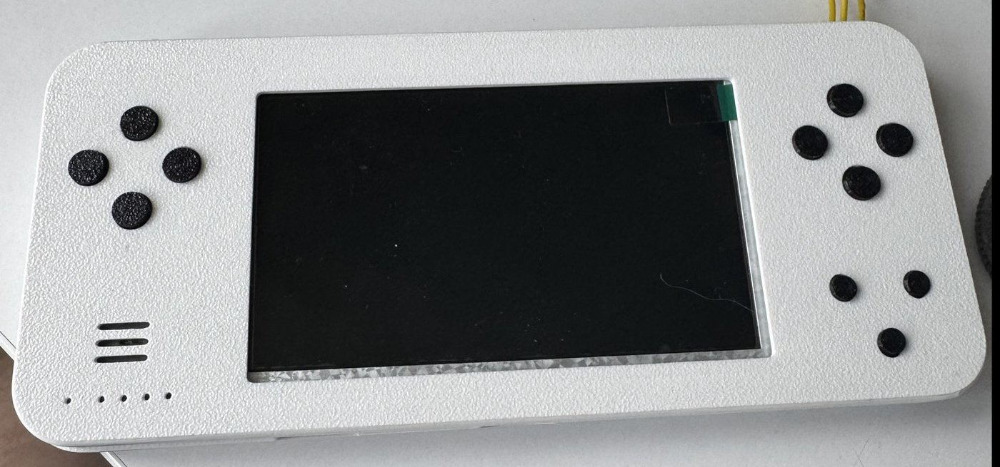
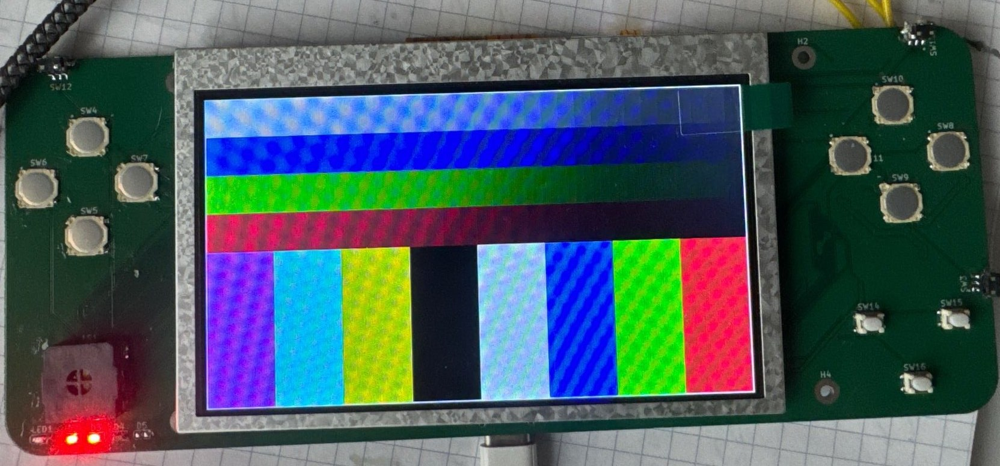
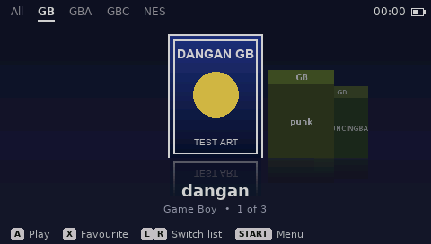
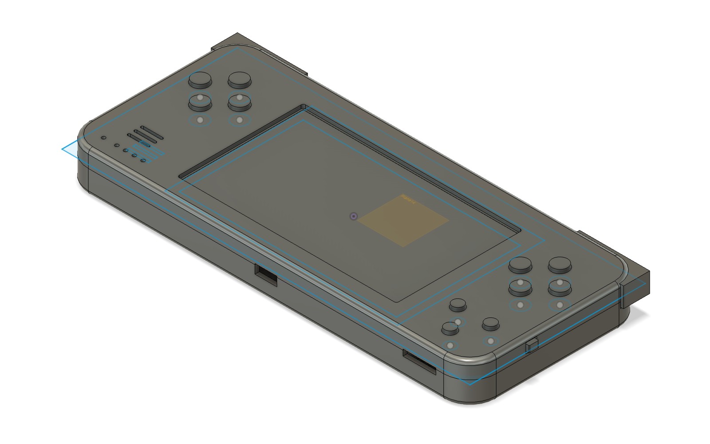
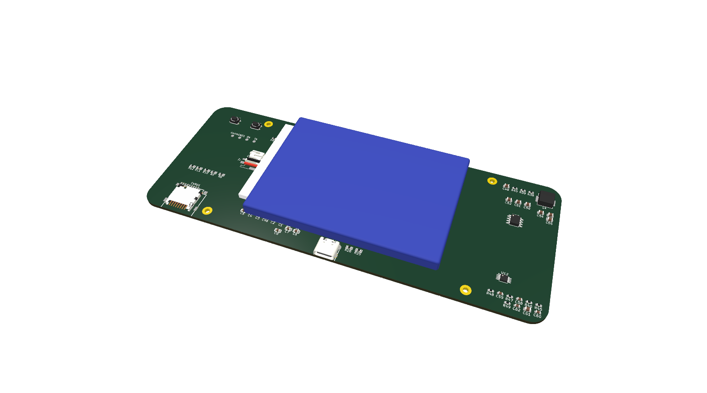

<p align="right"><b>English</b> · <a href="README.uk.md">Українська</a></p>

<h1 align="center">F1GameStation</h1>

<p align="center">
  An open-source, PSP-style handheld for 8- and 16-bit games,<br>
  built around the Allwinner F1C200s and running a port of MiyooCFW.
</p>

<p align="center">
  
  
  
  <a href="hardware/LICENSE"></a>
  <a href="firmware/LICENSE"></a>
  <a href="https://kami4ka.github.io/F1GameStation-Handheld/"></a>
</p>

<p align="center">
  
</p>

<p align="center">
  <a href="https://kami4ka.github.io/F1GameStation-Handheld/"><b>Interactive 3D model and board viewer</b></a> ·
  <a href="docs/BUILD.md"><b>Build guide</b></a> ·
  <a href="https://kami4ka.github.io/F1GameStation-Handheld/ibom.html"><b>Interactive BOM</b></a> ·
  <a href="firmware/README.md"><b>Firmware</b></a>
</p>

> [!NOTE]
> **Rev 1 is a fully working console**: LCD, sound, buttons, battery, backlight and USB all work, and it
> plays games. It is still a first revision with [known issues](#known-issues), so expect some hand work
> while building one.

## What it is

| | |
| --- | --- |
| **SoC** | Allwinner F1C200s (ARM926EJ-S, 64 MB DDR in package) |
| **Display** | 4.3" 480×272 RGB panel, 40-pin FPC (FPC043CS4001) |
| **Controls** | D-pad, A/B/X/Y, START, SELECT, MENU, PSP-style L/R triggers, side power button |
| **Power** | 1S Li-ion 606090 cell, IP5306 charger and boost, USB-C |
| **Audio** | SoC codec, NS4150B amplifier, on-board speaker |
| **Storage** | microSD (boot and games), optional 16 MB SPI flash |
| **Board** | 176 × 70 mm, 4 layers (JLC04161H-7628), JLCPCB assembly |
| **Case** | 186 × 80 mm, FDM-printed in PETG, M2 heat-set inserts |
| **Firmware** | MiyooCFW 2.0 with a 480×272 kernel driver, a 480×272 gmenu2x and a cover-flow launcher |

## Repository

```
hardware/       KiCad 10 project, fab package (Gerbers, BOM with LCSC numbers,
                positions, schematic PDF, interactive BOM), PCBA STEP
enclosure/      print/   STL and 3MF files, two-colour labelled caps for Bambu printers
                source/  Fusion 360 archives (.f3d), STEP, parametric Fusion scripts
firmware/       miyoocfw/  kernel patches, device tree, SD card scripts, Docker build
                launcher/  the cover-flow game launcher
                emulator/  a QEMU model of the handheld for development without hardware
docs/           build guide, images
site/           the project site (3D viewer, KiCanvas), deployed to GitHub Pages
```

## Build one

The [build guide](docs/BUILD.md) walks through it step by step:

1. **Order the board** from JLCPCB with the files in [`hardware/production`](hardware/production).
2. **Finish the assembly**: the SoC and DC-DC are supplied by you, then the LCD, battery and speaker.
3. **Build the firmware** from source and flash it to a microSD card ([firmware/README.md](firmware/README.md)).
4. **Print the case** from [`enclosure/print`](enclosure/print).
5. **Close it up** with four M2 heat-set inserts, two filament pins and four M2 × 12 screws.

No hardware yet? The [emulator](firmware/emulator/README.md) boots the same SD card image on a Mac.

## Status

| Block | State |
| --- | --- |
| SoC, DRAM, FEL, U-Boot, SD boot | ✅ working on two boards |
| Power rails (EA3059C bucks, 3V0 LDO) | ✅ working |
| Buttons (13 inputs) | ✅ working, see PA1–PA3 below |
| MiyooCFW kernel, menu, emulators | ✅ boots and runs |
| LCD | ✅ working |
| Audio (codec, amplifier, speaker) | ✅ working |
| Battery gauge | ✅ working |
| Backlight | ✅ working |
| USB high speed | ✅ working |

### Known issues

- **L, R and MENU (PA1, PA2, PA3) have no pull-ups.** These pins belong to the SoC's touch-panel block,
  and their internal pull-ups have no effect. The firmware works around it by charging each line and
  reading it straight away. Rev 2 should add 10 kΩ external pull-ups to 3V3.
- **No pin-1 marks on the silkscreen.** Check the orientation of every IC, LED and polarised part
  against the [interactive BOM](hardware/production/F1GameStation-ibom.html) before soldering.
- The L/R trigger switches have no locating holes for their pegs; trim the pegs and fit them by hand.

## Gallery

<p>
  
  
  
  
  
</p>

Launcher screenshots are emulator captures with homebrew games and placeholder art.

## Credits

- [MiyooCFW](https://github.com/MiyooCFW) for the kernel, root filesystem, gmenu2x and the emulator builds this firmware is based on.
- The SoC core comes from the author's earlier AnalogCoprocessor v3 board, tested over three revisions.
- [KiCanvas](https://kicanvas.org), [InteractiveHtmlBom](https://github.com/openscopeproject/InteractiveHtmlBom) and [three.js](https://threejs.org) for the project site.

## License

- Hardware (`hardware/`, `enclosure/`): [CERN-OHL-S-2.0](hardware/LICENSE)
- Firmware (`firmware/`, `site/tools/`): [GPL-2.0](firmware/LICENSE). Third-party parts keep their own licences (DejaVu fonts, MiyooCFW, QEMU).
- Documentation and images (`docs/`): [CC BY-SA 4.0](docs/LICENSE)
