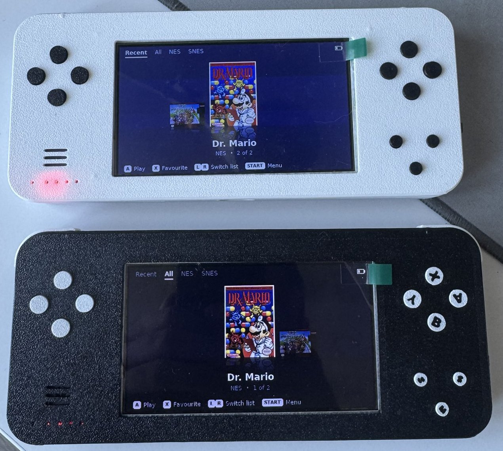
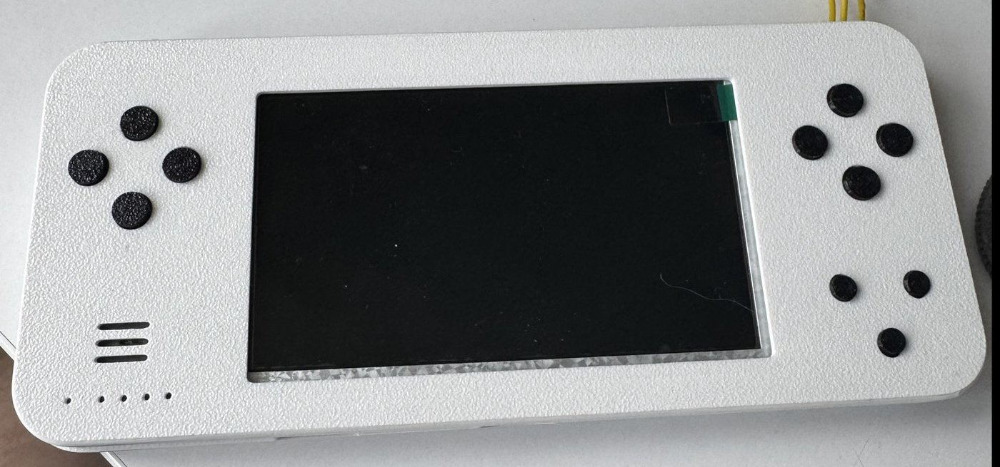
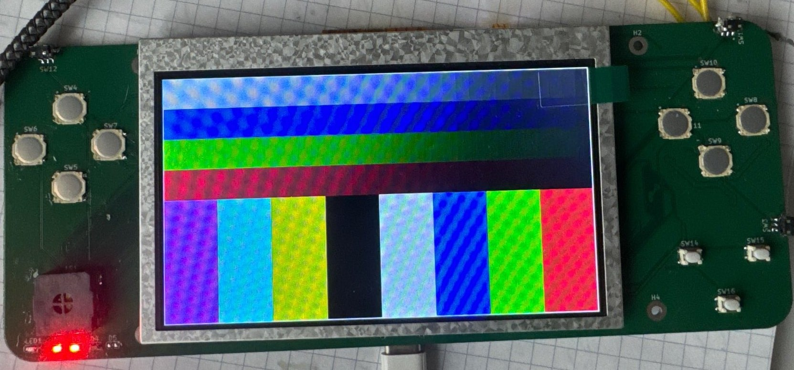
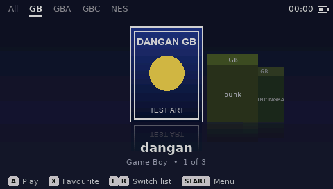
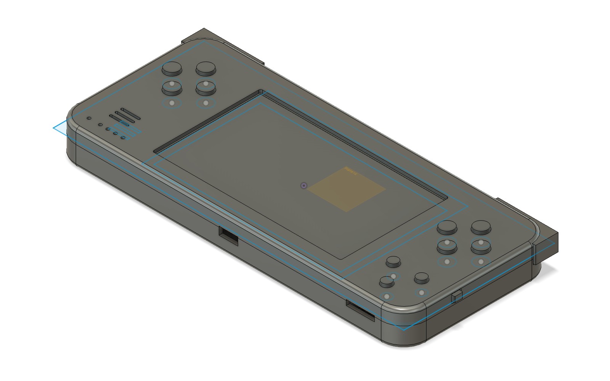
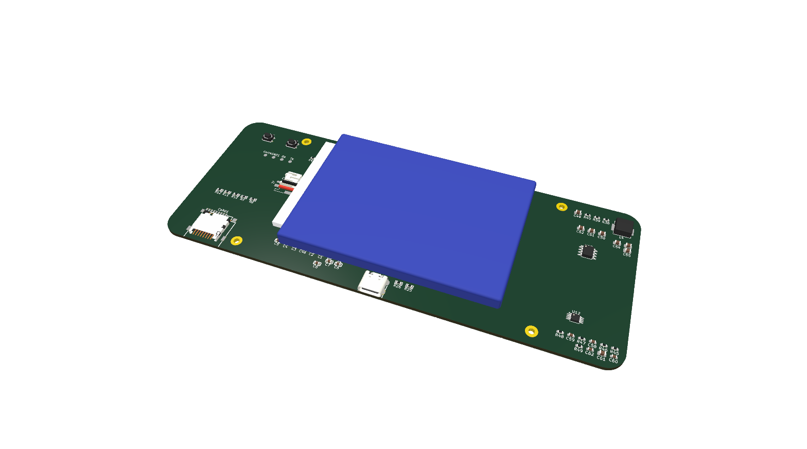

<p align="right"><a href="README.md">English</a> · <b>Українська</b></p>

<h1 align="center">F1GameStation</h1>

<p align="center">
  Відкрита портативна консоль у стилі PSP для 8- і 16-бітних ігор,<br>
  побудована на Allwinner F1C200s з портом MiyooCFW.
</p>

<p align="center">
  
  
  
  <a href="hardware/LICENSE"></a>
  <a href="firmware/LICENSE"></a>
  <a href="https://kami4ka.github.io/F1GameStation-Handheld/"></a>
</p>

<p align="center">
  
</p>

<p align="center">
  <a href="https://kami4ka.github.io/F1GameStation-Handheld/"><b>Інтерактивна 3D модель і перегляд плати</b></a> ·
  <a href="docs/BUILD.md"><b>Інструкція зі збирання</b></a> (англ.) ·
  <a href="https://kami4ka.github.io/F1GameStation-Handheld/ibom.html"><b>Інтерактивний BOM</b></a> ·
  <a href="https://github.com/kami4ka/F1GameStation-Handheld/releases"><b>Образ SD-картки</b></a>
</p>

> [!NOTE]
> **Rev 1 — повністю робоча консоль**: екран, звук, кнопки, батарея, підсвітка й USB працюють, ігри
> запускаються. Це все ж перша ревізія з [відомими недоліками](#відомі-недоліки), тож під час збирання
> доведеться трохи попрацювати руками.

## Що це

| | |
| --- | --- |
| **SoC** | Allwinner F1C200s (ARM926EJ-S, 64 МБ DDR у корпусі) |
| **Екран** | 4,3" 480×272 RGB, 40-контактний шлейф (FPC043CS4001) |
| **Керування** | хрестовина, A/B/X/Y, START, SELECT, MENU, курки L/R як у PSP, бічна кнопка живлення |
| **Живлення** | Li-ion 1S 606090, зарядка й boost IP5306, USB-C |
| **Звук** | кодек SoC, підсилювач NS4150B, динамік на платі |
| **Пам'ять** | microSD (система й ігри), опційно SPI flash 16 МБ |
| **Плата** | 176 × 70 мм, 4 шари (JLC04161H-7628), монтаж на JLCPCB |
| **Корпус** | 186 × 80 мм, друк FDM з PETG, різьбові вставки M2 |
| **Прошивка** | MiyooCFW 2.0 з драйвером екрана 480×272, gmenu2x під 480×272 і лаунчером cover-flow |

## Структура репозиторію

```
hardware/       проєкт KiCad 10, файли для виробництва (Gerber, BOM з номерами LCSC,
                координати, схема в PDF, інтерактивний BOM), STEP зібраної плати
enclosure/      print/   STL і 3MF, двоколірні ковпачки кнопок з написами для принтерів Bambu
                source/  архіви Fusion 360 (.f3d), STEP, параметричні скрипти Fusion
firmware/       miyoocfw/  патчі ядра, device tree, скрипти SD-картки, збирання в Docker
                launcher/  лаунчер ігор cover-flow
                emulator/  модель консолі в QEMU для розробки без заліза
docs/           інструкція зі збирання, зображення
site/           сайт проєкту (3D переглядач, KiCanvas) для GitHub Pages
```

## Як зібрати

Покроково в [інструкції зі збирання](docs/BUILD.md) (англійською):

1. **Замовте плату** на JLCPCB з файлами з [`hardware/production`](hardware/production).
2. **Допаяйте плату**: SoC і DC-DC ставите самі, потім екран, батарею й динамік.
3. **Запишіть microSD** з [готовим образом](https://github.com/kami4ka/F1GameStation-Handheld/releases) або [зберіть прошивку](firmware/README.md).
4. **Надрукуйте корпус** з [`enclosure/print`](enclosure/print).
5. **Зберіть усе разом**: чотири вставки M2, два штифти з філаменту й чотири гвинти M2 × 12.

Ще немає заліза? [Емулятор](firmware/emulator/README.md) запускає той самий образ SD-картки на Mac.

## Стан

| Блок | Стан |
| --- | --- |
| SoC, DRAM, FEL, U-Boot, завантаження з SD | ✅ працює на двох платах |
| Живлення (EA3059C, LDO 3V0) | ✅ працює |
| Кнопки (13 входів) | ✅ працюють, див. PA1–PA3 нижче |
| Ядро MiyooCFW, меню, емулятори | ✅ завантажуються й працюють |
| Екран | ✅ працює |
| Звук (кодек, підсилювач, динамік) | ✅ працює |
| Заряд батареї | ✅ працює |
| Підсвітка | ✅ працює |
| USB High Speed | ✅ працює |

### Відомі недоліки

- **L, R і MENU (PA1, PA2, PA3) без підтяжок.** Ці виводи належать блоку сенсорної панелі SoC, і
  внутрішні підтяжки на них не діють. Прошивка обходить це: заряджає лінію й одразу її читає.
  У Rev 2 варто додати зовнішні резистори 10 кОм до 3V3.
- **На шовкографії немає позначок першого виводу.** Звіряйте орієнтацію мікросхем, світлодіодів і
  полярних компонентів з [інтерактивним BOM](hardware/production/F1GameStation-ibom.html) перед паянням.
- Для ніжок кнопок курків L/R на платі немає отворів: обріжте їх і ставте кнопки вручну.

## Галерея

<p>
  
  
  
  
  
</p>

Знімки лаунчера зроблені в емуляторі з homebrew-іграми та тестовими обкладинками.

## Подяки

- [MiyooCFW](https://github.com/MiyooCFW) за ядро, кореневу файлову систему, gmenu2x і збірки емуляторів.
- Ядро SoC взято з попередньої плати автора AnalogCoprocessor v3, перевіреної в трьох ревізіях.
- [KiCanvas](https://kicanvas.org), [InteractiveHtmlBom](https://github.com/openscopeproject/InteractiveHtmlBom) і [three.js](https://threejs.org) для сайту проєкту.

## Ліцензія

- Залізо (`hardware/`, `enclosure/`): [CERN-OHL-S-2.0](hardware/LICENSE)
- Прошивка (`firmware/`, `site/tools/`): [GPL-2.0](firmware/LICENSE). Сторонні частини мають власні ліцензії (шрифти DejaVu, MiyooCFW, QEMU).
- Документація й зображення (`docs/`): [CC BY-SA 4.0](docs/LICENSE)
